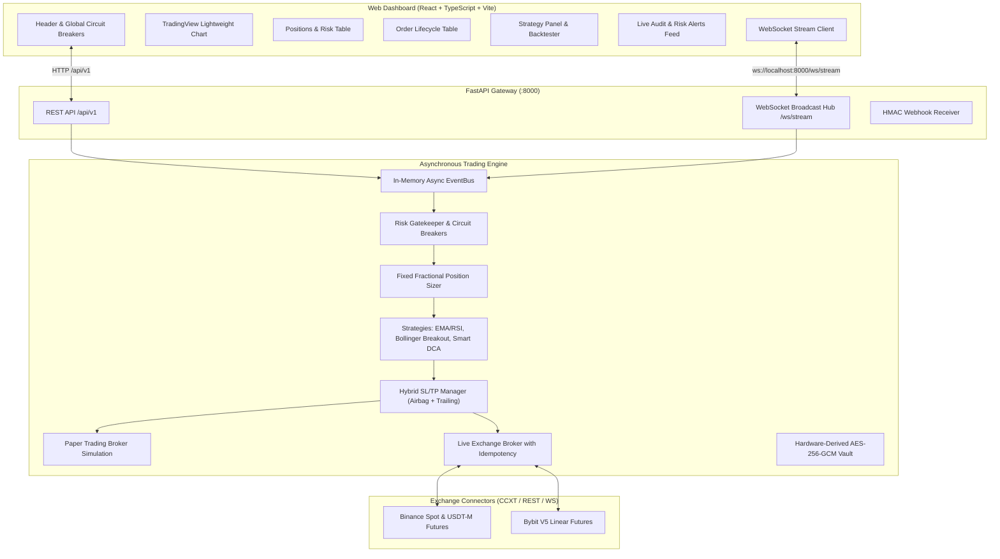

# Automated Crypto Trading Platform (Phase 1: CEX Algorithmic Engine)

A high-performance, single-tenant algorithmic trading system engineered for **Binance** and **Bybit** across **Spot** and **USDT-M Perpetual Futures** with leverage.

---

## 🏛 System Architecture Overview



---

## 🚀 Quickstart Guide

### 1. Prerequisites
- **Python 3.11+** (Tested on Python 3.14.0)
- **Node.js 18+** & npm (Tested on Node v26.13.0)

### 2. Backend Setup & Run
```powershell
cd E:\Codes\crypto_trading_platform\backend

# Run test suite across all milestones (1-6)
python -m pytest tests/unit -v

# Start FastAPI server
python -m uvicorn app.main:app --host 127.0.0.1 --port 8000 --reload
```
The REST API will be available at `http://localhost:8000` with interactive OpenAPI documentation at `http://localhost:8000/docs`.

**Database migrations** (Alembic, in `backend/migrations`) run automatically when the server starts. A database created before migrations existed is detected and upgraded in place. To run them by hand, or to add one after changing `app/models/entities.py`:
```powershell
python -m alembic upgrade head
python -m alembic revision --autogenerate -m "describe the change"
```
Decimal columns use `ExactDecimal`: TEXT on SQLite (SQLite's NUMERIC is a binary float), NUMERIC on PostgreSQL. Do sums and comparisons on them in Python, not in SQL.

### 3. Frontend Setup & Run
```powershell
cd E:\Codes\crypto_trading_platform\frontend

# Install dependencies (already installed)
npm install

# Start Vite dev server
npm run dev

# Or build for production
npm run build
```
The Web Dashboard runs at `http://localhost:5173`.

### 4. Docker Quickstart (24/7 Cloud Host or Local)
```bash
docker compose up -d
```
The Web Dashboard is served on port 80 at `http://localhost` (or `http://<your-vps-ip>`) with automatic REST API and WebSocket reverse-proxying.

---

## 🛡 Risk Management & Execution Principles
1. **Zero Floating Point Math**: All financial calculations (equity, order size, prices, fees, PnL) utilize Python's exact `Decimal` arithmetic.
2. **Two-Tier Hybrid Stop-Loss**:
   - **Tier-1**: Exchange-side hard stop-loss order placed immediately upon entry (airbag protection).
   - **Tier-2**: Engine-managed dynamic multi-stage take-profit and breakeven trailing stop.
3. **Strict Single-Tenant Isolation**: AES-256-GCM credential encryption with ephemeral RAM keys.
4. **Global Circuit Breakers**:
   - Max 5 concurrent positions.
   - Max 5.0% daily drawdown threshold.
   - One-Way Mode & Isolated Margin defaults.
   - 1-click Emergency Kill Switch.

## ⚡ Live Execution
- **Turning it on**: set a strategy's `execution_mode` to `LIVE` and its `exchange_connection_id` to an enabled exchange connection. Every other strategy keeps paper trading.
- **When strategies run**: on Binance's kline WebSocket, the moment a candle closes. A 15s housekeeping loop also refreshes strategies and polls any symbol whose stream is stale over REST. Set `MARKET_STREAM_ENABLED=false` to use polling only.
- **Entry flow**: risk gatekeeper → size from `min(balance, connection capital cap)` → futures symbol set to isolated margin with `risk_config.leverage` (default 1x) → market order → exchange-side stop. If the stop cannot be placed, the position is closed at once.
- **Futures stops**: placed through Binance's Algo Order API (`/fapi/v1/algoOrder`). Binance has rejected `STOP_MARKET` on `/fapi/v1/order` since December 2025.
- **Stop fills**: checked every housekeeping cycle. A filled exchange stop closes the position in the database. A stop that disappears raises a `STOP_LOSS_MISSING` alert.
- **Clock**: request timestamps are corrected by Binance's server time. A `-1021` rejection re-syncs the clock and retries once.
- **Not supported live yet**: Smart DCA safety scale-ins (they are skipped).
